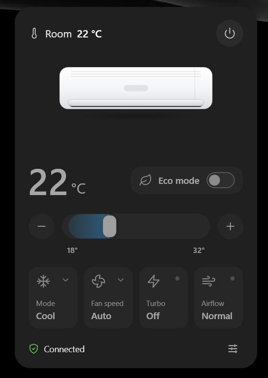

# Daikin Desktop Controller

[](https://github.com/jvopereira/daikin-desktop-controller/actions/workflows/ci.yml)
[](https://github.com/jvopereira/daikin-desktop-controller/releases)
[](LICENSE)

Control a compatible Daikin air conditioner from a lightweight Windows system-tray app. The controller communicates with the unit over your local network and keeps everyday controls in a compact panel.



## Features

- Discover and pair with compatible air conditioners on your local network, or configure an address manually.
- Control power, target temperature, operating mode, fan speed, Turbo, Comfort, and Economy when the unit reports support.
- See connection status and have the panel reconcile pending commands with the device's reported state.
- Choose English or Brazilian Portuguese, and Light, Dark, or System appearance.
- Keep the app in the system tray, launch it at sign-in, and store the device secret in Windows Credential Manager.
- Keep control traffic local; the app does not depend on a cloud service.

> Compatibility depends on the air conditioner model, firmware, and local-network configuration. The app is an independent community project and is not affiliated with or endorsed by Daikin.

## Requirements

- Windows 10 or 11
- .NET 10 SDK to build from source
- A compatible Daikin air conditioner reachable on the same local network
- The device secret key required by the air conditioner

## Get started

### Install on Windows

1. Open [Releases](https://github.com/jvopereira/daikin-desktop-controller/releases).
2. Open the latest version and download its Windows installer from **Assets**.
3. Run the downloaded installer and follow the on-screen steps.
4. Open **Daikin Desktop Controller** from the Start menu. On first launch, enter your device secret key and select your air conditioner.

After setup, the app stays in the system tray. Select its tray icon whenever you want to open the control panel.

The device key is stored in Windows Credential Manager. Network discovery and control require the computer and air conditioner to be able to communicate on the local network.

## Build from source

To build the app yourself, install the .NET 10 SDK and run these commands in PowerShell from the repository root:

```powershell
dotnet restore
dotnet build -c Release --no-restore
dotnet test -c Release --no-build
dotnet run --project src/DaikinDesktopController.App
```

The WPF desktop app and its UI tests require Windows. Device protocol tests target plain .NET and can also run on macOS or Linux:

```sh
dotnet test tests/DaikinDesktopController.Device.Tests
```

## Contributing

Contributions are welcome. For a significant behavior or UI change, open an issue first to discuss the approach. For smaller fixes, open a pull request with a concise description, the user-visible impact, and the checks you ran. Please do not include device keys, credentials, or private network details in issues, screenshots, or logs.

Before opening a pull request:

1. Keep changes focused and follow the existing C# conventions and nullable/warnings-as-errors settings.
2. Run `dotnet build -c Release` and the relevant tests on Windows; run device protocol tests on other platforms when applicable.
3. Run `npx --yes markdownlint-cli2 "**/*.md"` and `lychee --no-progress README.md` when changing documentation.
4. Update user-facing documentation when behavior or setup changes.

Every pull request should explain what changed, why it is useful, how it was verified, and include screenshots for visible UI changes.

## License

This project is licensed under the [MIT License](LICENSE).
